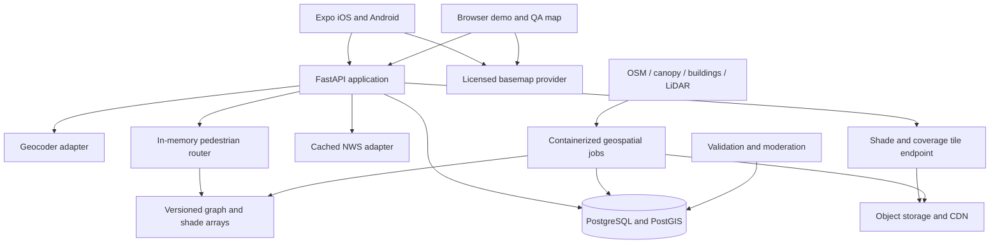

# ShadeATL — end-to-end implementation plan

Prepared September 25, 2026. Working product name; branding is optional.

**Build a native iOS/Android walking app that helps someone trade a few extra minutes for less time in direct sun, using Atlanta's actual pedestrian network, tree canopy, buildings, and departure time.** React Native with Expo is the recommended client. A Python geospatial backend owns shade computation and routing.

This document is an implementation specification, not a claim that the app or datasets have already been built or validated. External facts are linked to primary sources. Algorithms, thresholds, schedules, and capacity figures are proposed engineering choices to test.

## 1. Product decisions and scope

The default experience is: choose a destination, compare routes, understand the difference, and start walking. The headline should be **“4 extra minutes, about 6 fewer minutes in direct sun.”** That example is illustrative, not a measured Atlanta result.

| Decision | Recommendation |
|---|---|
| Geographic promise | City of Atlanta municipal boundary; do not imply the entire metro area |
| Initial demonstration | A verified, connected Georgia Tech–Midtown area, followed by Downtown and selected BeltLine approaches |
| Users | Students, commuters, residents, and visitors making roughly 5–45 minute walks |
| Platforms | Native iOS and Android with Expo development builds; browser demo through a separate map adapter |
| Main routes | Fastest, Recommended, Shade-first |
| Core optimization | Minimize expected direct-sun exposure within a user-visible extra-time budget |
| Default budget | Up to 20% longer, capped at 5 extra minutes; adjustable |
| Shade-first budget | Up to 40% longer, capped at 10 extra minutes; adjustable |
| Accounts | No sign-in required for searching or navigating; favorites stored locally initially |
| Accessibility | Respect known restrictions; offer “avoid stairs.” Verified wheelchair routing comes later |
| Product claim | Estimated shade and exposure, with coverage/confidence; no invented temperature or health benefit |
| Business scope | A useful consumer app first; a city planning dashboard is a later extension |

Budget defaults are hypotheses for usability testing, not scientific constants. If every useful route is effectively the same, show one route and explain that alternatives offer little improvement. Never manufacture three choices.

The full ambition is citywide pedestrian coverage with time-aware building and tree shadows, reliable guidance, field validation, and maintained data. A hackathon delivers a genuine vertical slice of that system. Citywide completeness and verified accessibility require additional fieldwork and data access; they are not credible weekend promises.

### Lessons from Singapore

Undercover compares short, shaded, and balanced routes. Its Silverfox engine uses flexible edge costs, and its published implementation combines pedestrian coverage data with sun-position-based building shadows. The write-up lists trees, real-time weather, and accessibility data among remaining work. These are useful architectural ideas, not evidence that the Singapore engine or its data are available for reuse. Build Atlanta's implementation independently unless reusable code and a suitable license are actually located. [Undercover project](https://www.hack.gov.sg/2026/undercover/)

For Atlanta, make vegetation a first-class input and explicitly handle seasonal foliage, hills, incomplete sidewalks, divided roads, and uncertain public access. Do not transfer Singapore's reported performance or heat-stress claims to this app.

## 2. Complete user experience

### Discover and plan

1. Open an Atlanta map with destination search and a “Choose on map” alternative.
2. Ask for foreground location only when the user chooses “My location.” A typed origin must work without permission.
3. Search addresses, parks, campus destinations, and transit entrances. Bias results to Atlanta, then validate service-area coverage separately.
4. Let users choose departure date/time, walking pace, extra-time budget, and “avoid stairs.” Keep defaults usable without opening settings.
5. Present route cards with walking time, distance, estimated sun minutes, shaded distance percentage, and meaningful uncertainty.
6. Selecting a card highlights it and dims other routes. Explain the recommendation in one sentence based on returned metrics.
7. A time slider updates shade and route estimates. Debounce requests and cancel obsolete ones so a previous response cannot replace a newer choice.

Shaded percentage measures distance under modeled cover; expected direct-sun minutes measure exposure over time. Show both with clear labels. A cloudy day does not make an uncovered street physically shaded. At night, show “No direct sunlight expected” and remove sun-based route ranking instead of reporting 100% shade.

### Walk

The navigation screen shows the next maneuver, remaining time, remaining exposed time, current route, GPS accuracy, and upcoming long exposed stretches. Provide text instructions, optional speech and haptics, a recenter control, and a prominent end-navigation action.

Generate maneuvers from the actual pedestrian graph: “Use the crosswalk,” “Continue along the path,” and entrance directions matter more than car-style turns. Crossing waits contribute to both ETA and exposure. Do not direct someone to switch sidewalks halfway along a block.

The first release navigates while foregrounded. Add lock-screen/background guidance only after native permissions, interruption recovery, and physical-device tests pass. Expo documents separate foreground/background permissions and development-build requirements for background location. [Expo Location](https://docs.expo.dev/versions/latest/sdk/location/)

Map matching should consider accuracy radius, heading, progress, and graph connectivity. Initial reroute rule: several consecutive good fixes more than roughly 25–40 m from the route, adjusted to device accuracy, plus a cooldown. Test this rule in urban canyons; one noisy GPS fix must not trigger repeated rerouting or a false crossing instruction.

### Finish and improve

At arrival, display predicted exposure for the completed route, clearly distinguished from sensor-measured exposure. Offer optional feedback: blocked path, missing sidewalk, incorrect access, missing shade, or stale tree/building data. Location, time, edge, and model version accompany a report; photos are optional. Review reports before they change route eligibility.

### Essential states

Design permission denied, approximate GPS, out-of-area, disconnected network, no eligible route, unknown shade, weather unavailable, expired forecast, network loss, route changed by closure, and app-resume states. Keep a cached route and its guidance usable during a connection loss; offline rerouting is a later capability and must not be implied.

Use large outdoor-readable controls, screen-reader labels, text alternatives to map colors, route line patterns, dynamic type, and reduced motion. A map alone is insufficient for comparing routes.

## 3. Atlanta data acquisition and evidence

**The data pipeline is the principal technical risk.** A plausible-looking map is not enough. Every source needs a coverage check, timestamp, license, geometry inspection, and reproducible import.

| Layer | Starting source and verified fact | Still to verify | Fallback |
|---|---|---|---|
| City boundary | Atlanta's GIS service lists a city-limits layer | Current boundary vintage and redistribution terms | A separately verified municipal boundary source |
| Walking network | Geofabrik publishes a Georgia OSM extract | Sidewalk/crossing completeness, access tags, entrance connectivity | Curated pedestrian corrections in the pilot area |
| Tree canopy | Georgia Tech publishes 2023 canopy resources and links a download hub | Fine-resolution canopy geometry/raster availability, resolution, export permissions, imagery date | Older usable canopy with visible age, or small-area licensed imagery classification |
| Buildings | Atlanta GIS exposes footprint polygons and credits Microsoft | Source lineage; completeness; whether elevation fields contain valid data and documented units | Direct Microsoft/OSM footprints plus derived or explicitly estimated heights |
| Heights and terrain | USGS 3DEP offers point clouds and elevation products | Which acquisition tiles cover Atlanta; collection date, density, classification, leaf condition, vertical datum | Valid city height fields or OSM heights; mark unmeasured values as estimates |
| Crossings and road context | Atlanta DPW directory exposes signal and pedestrian-beacon services | Reuse terms, positional accuracy, relevance to an actual walkable crossing | OSM crossings plus local verification |
| Closures | DPW lists current/future traffic-control permit services | Whether a permit actually closes a sidewalk and during what hours | Moderated, time-limited manual closures |
| Weather | NWS provides forecasts and alerts | Cache behavior and field availability at Atlanta forecast grids | Geometric shade with weather marked unavailable |
| Map and search | MapTiler provides map services and a geocoding API | Selected plan's mobile usage, storage, offline, attribution, and quota terms | Interchangeable paid provider or self-hosted search later |

Sources: [Atlanta GIS](https://gis.atlantaga.gov/dpcd/rest/services/OpenDataService1/MapServer), [Georgia OSM extract](https://download.geofabrik.de/north-america/us/georgia.html), [Georgia Tech canopy resources](https://geospatial.gatech.edu/AtlantaUTC/), [Atlanta footprint schema](https://gis.atlantaga.gov/dpcd/rest/services/OpenDataService1/MapServer/10), [USGS LidarExplorer](https://www.usgs.gov/tools/lidarexplorer), [Atlanta DPW services](https://dpwgis.atlantaga.gov/hostingserver/rest/services), [NWS API](https://www.weather.gov/documentation/services-web-api), [MapTiler geocoding](https://docs.maptiler.com/cloud/api/geocoding/).

The canopy study is newer than the 2018 report still surfaced on some city pages: Trees Atlanta announced the 2023 data release in August 2026. The linked ArcGIS application was discoverable during this research, but its underlying fine-resolution download, license, and contents were not verified. Neighborhood canopy percentages cannot replace a street-level canopy mask. [Trees Atlanta release](https://www.treesatlanta.org/resources/urban-tree-canopy-study/), [Canopy download hub](https://experience.arcgis.com/experience/a5cc602b023f42cdbbb6a1d2a35e8ec8)

The inspected footprint schema includes `STORIES`, `BASEELEV`, and `ROOFELEV`; their existence does not establish populated or trustworthy heights. Audit nulls, units, datum, and sample buildings before deriving `ROOFELEV - BASEELEV`. The service advertises a 2,000-record response limit and pagination, so imports must page through all records and check totals. [Footprint layer metadata](https://gis.atlantaga.gov/dpcd/rest/services/OpenDataService1/MapServer/10)

### First data spike: produce artifacts, not assumptions

Within the first development day:

1. Download one fixed OSM snapshot; clip to the pilot plus a processing buffer.
2. Export one pilot-area footprint sample; report field population and geometry quality.
3. Resolve the canopy hub to an actual layer/file and its terms. Determine whether it contains canopy surfaces or only aggregate statistics.
4. Use 3DEP's spatial metadata/LidarExplorer to identify an intersecting project and retrieve one tile. Record its exact acquisition ID rather than guessing a Georgia project covers Atlanta.
5. In QGIS, overlay paths, crossings, canopy, buildings, terrain, and imagery where permitted.
6. Walk or inspect 10–20 representative blocks and compare geometry with actual pedestrian access.
7. Write `data-catalog.json`, `coverage.geojson`, `quality-report.json`, and a reproducible command that rebuilds the pilot.

**Decision gate:** proceed with dynamic tree shadows only if usable canopy extent and heights exist. Otherwise deliver a clearly labeled canopy proxy plus time-varying building shadows. Do not manufacture tree positions or imply a proxy is a physically validated shadow model.

### Data provenance and reuse

For every source record: URL, publisher, upstream ID, acquisition date, publication date, download date, license, attribution, CRS, vertical datum, units, checksum, resolution, coverage, and processing version. Keep raw inputs immutable and separate from derived releases.

OSM uses ODbL; Microsoft's US footprints also state ODbL. Plan attribution and applicable derived-database sharing obligations before publishing combined data, preserving source lineage for review. A public ArcGIS endpoint alone is not a redistribution license. USGS states its 3DEP products are available without use restrictions. [OSM license](https://www.openstreetmap.org/copyright), [Microsoft data license](https://github.com/microsoft/USBuildingFootprints), [3DEP products](https://www.usgs.gov/3d-elevation-program/about-3dep-products-services)

## 4. Architecture and stack



Keep the API, routing module, search adapter, and tile endpoints in one deployable backend initially. Run ETL as separate batch jobs because data preparation and interactive requests have different memory and latency needs. The diagram is a logical architecture, not a requirement to operate ten microservices.

| Component | Recommended implementation | Reason |
|---|---|---|
| Mobile | React Native, Expo, TypeScript, Expo Router | Native distribution and a shared app codebase |
| Native map | `@maplibre/maplibre-react-native` | Styled vector maps and custom shade/route layers |
| Browser map | MapLibre GL JS behind `MapCanvas.web.tsx` | Reliable browser presentation without assuming native renderer parity |
| UI state | React state for local state; TanStack Query for server data | Keep route request/cache behavior explicit |
| Local persistence | Expo SQLite; SecureStore only for credentials if introduced | Offline route packets and local favorites |
| API | FastAPI, Pydantic, OpenAPI-generated TypeScript client | Strong contract with the Python geospatial stack |
| Spatial storage | PostgreSQL + PostGIS | Geometry, source metadata, reports, releases, spatial queries |
| ETL | Python, GDAL/Rasterio, GeoPandas/Shapely, PDAL, PyProj | Inspectable raster/vector/point-cloud processing |
| Sun position | pvlib solar-position routines | Tested solar geometry with explicit timezone inputs |
| Graph preparation | pyosmium for PBF ingestion; OSMnx for pilot graph exploration | Reproducible city extracts and fast prototypes |
| Routing | Python reference implementation; compact arrays for service execution | Custom shade costs and transparent correctness testing |
| Assets | S3-compatible object storage, immutable keys, CDN | Large geospatial files stay outside Git and request workers |
| Deployment | Docker containers, managed PostGIS, one warm API instance initially | Simple operations and predictable graph loading |
| Testing | pytest, TypeScript checks, React Native Testing Library, Maestro | Geometry/algorithm validation plus physical mobile flows |

MapLibre's Expo setup requires its config plugin and an app rebuild. Current MapLibre documentation also sets React Native/new-architecture requirements. During the initial compatibility spike, choose a stable Expo SDK with a compatible React Native version, pin the full dependency matrix, and build both platforms. Do not plan around Expo Go or copy code samples from a different MapLibre major version. [MapLibre setup](https://maplibre.org/maplibre-react-native/docs/setup/expo/), [MapLibre requirements](https://maplibre.org/maplibre-react-native/docs/setup/getting-started/), [Expo development builds](https://docs.expo.dev/develop/development-builds/introduction/)

OSMnx supports pedestrian network work and graph conversion; it is not a turnkey sidewalk-completeness guarantee. PDAL supports height-above-ground computation against a terrain raster. PostGIS can produce vector tiles. Use those capabilities as building blocks and validate the composed pipeline. [OSMnx reference](https://osmnx.readthedocs.io/en/stable/user-reference.html), [PDAL height filter](https://pdal.io/en/stable/stages/filters.hag_dem.html), [PostGIS vector tiles](https://postgis.net/docs/ST_AsMVT.html)

### Proposed repository

```text
apps/
  mobile/                 Expo app; native and browser map adapters
  qa/                     Small internal map for data inspection/moderation
packages/
  api-client/             Generated TypeScript API types and client
  ui/                     Shared presentation components
services/
  api/                    FastAPI, search/weather adapters, route endpoints
  routing/                Graph loading, objectives, search, maneuvers
pipelines/
  ingest/                 Source-specific readers and manifests
  pedestrian/             Graph construction and topology validation
  shade/                  Heights, canopy, sun position, obstruction sampling
  publish/                Immutable release creation and promotion
infra/                    Containers, local compose, deployment configuration
data/
  fixtures/               Small synthetic and legally redistributable fixtures
  manifests/              Source and release manifests; large data excluded
tests/
  routing/ geometry/ contracts/ mobile/ field/
docs/                     Data decisions, runbooks, evaluation reports
```

Use a JavaScript workspace manager for apps/packages and a Python lockfile for backend/jobs. Local development on this Windows workspace should use Docker/WSL2 for GDAL/PDAL consistency. EAS can produce iOS builds from a Windows workflow; local iOS simulation still requires an appropriate macOS/Xcode environment. Verify actual signing and device-install access early. [Expo EAS Build](https://docs.expo.dev/build/introduction/)

## 5. Build a pedestrian graph people can actually follow

### Coordinate and network rules

Use longitude/latitude in GeoJSON and API payloads, and an explicitly selected metric projection for distance, buffers, and shadow calculations; WGS84 / UTM zone 16N is a reasonable candidate to validate for this scope. Never measure meters in EPSG:4326 or subtract vertical elevations with incompatible units/datums. Preserve original source CRS metadata.

Import the municipal polygon, then a routing buffer to avoid artificial border disconnections and a separate shadow buffer sized for nearby occluders. Initially restrict eligible route geometry to the declared service area. Support buffered boundary excursions only after those paths pass the same validation gates and the coverage policy explicitly includes them.

Preserve paths, footways, sidewalks, crossings, pedestrian streets, stairs, bridges, tunnels, access restrictions, opening hours, and foot-specific directionality. Do not apply vehicle one-way rules blindly to pedestrians. Retain disconnected components and classify them rather than dropping everything except the largest component.

### Sidewalk geometry is a release gate

1. Prefer separately mapped sidewalks and public paths.
2. Use city sidewalk geometry only after verifying it represents usable paths rather than a condition survey or polygon artifact.
3. Where only a road centerline and sidewalk tags exist, create an estimated side representation only with documented width assumptions and junction treatment.
4. Keep inferred geometry explicitly flagged and lower-confidence. Do not claim which side is shadier unless positional accuracy supports it.
5. Connect opposite sides only at verified legal crossings; require layer/level agreement when connecting intersecting lines.
6. Avoid duplicate centerline and sidewalk representations that create shortcut opportunities.

Exclude motorways, prohibited access, unsupported private shortcuts, and known closures. A shaded route may never compensate for prohibited access through a favorable numerical weight. Missing sidewalk evidence is not evidence of a safe walking route; withhold unverified high-risk links and disclose where coverage ends.

Handle curb transitions, gates, fences, grade separation, park hours, campus access, and stairs explicitly. For accessible routing later, slope, curb ramps, surface, width, and elevator reliability need their own evidence; “avoid stairs” alone cannot certify accessibility.

### Origins and destinations

Snap to a reachable pedestrian edge or verified public entrance, not the nearest road across a fence. Split the edge at the snapped point and preserve partial-edge distance, shade samples, and direction. Keep the user's original pin and the snapped access point so the UI can explain the approach. A connector must be checked for barriers and public access; otherwise request another entrance/pin or return `NO_WALKABLE_ACCESS`.

Initial snap distance limit: 50 m where appropriate, configurable by coverage class. Never silently bridge hundreds of meters of missing network. For building destinations use an entrance, not the centroid; do not route through a building unless its public passage and hours have been verified.

Graph QA includes barrier crossings, impossible intersections, missing bridge layers, spurious stairs, duplicated paths, zero-length edges, disconnected entrances, directionality, and known benchmark origin/destination pairs.

## 6. Shade model: physically meaningful, computationally practical

### Representation

For each path sample and time, estimate:

- `structural_blocked`: direct beam blocked by buildings, terrain, or verified permanent cover.
- `canopy_transmittance`: fraction of direct beam passing through vegetation; uncertain and season-dependent.
- `unknown`: inadequate geometry, height, foliage, or coverage evidence.

Take spatial samples every approximately 2–5 m in the pilot and test sensitivity before choosing citywide spacing. Shorten spacing around shadow boundaries. Preserve sample positions/offsets, not just an average edge score, so partial edges and arrival-time exposure remain computable.

### Building and terrain shadows

Compute solar azimuth/elevation for timestamp and location using timezone-aware inputs. Store UTC; display `America/New_York`, including daylight-saving transitions. pvlib expects localized times or assumes UTC, so test conversion explicitly. [Solar-position API](https://pvlib-python.readthedocs.io/en/latest/reference/generated/pvlib.solarposition.get_solarposition.html)

For flat-ground intuition, an obstruction of relative height `h` casts a shadow length `h / tan(solar_elevation)` opposite the sun's horizontal direction. A footprint merely translated by that distance is insufficient: construct the swept shadow region or perform ray intersections. Real implementation must compare source and receiver elevations.

For a path sample, cast a ray toward the sun from an explicit receiver height above local ground. A first pedestrian-body approximation could use 1 m, with ground/head-height sensitivity evaluated before release. Intersect building meshes/prisms or sample a terrain/surface representation. Resolve roof elevations against local ground and handle terrain in the ray test.

A bare-earth DEM omits buildings and vegetation. Use it for terrain; obtain obstructions from point clouds, canopy, and buildings. USGS distinguishes these products explicitly. [USGS point clouds and DEMs](https://www.usgs.gov/faqs/what-lidar-data-and-where-can-i-download-it?items_per_page=6&page=1)

Do not assume a standard surface raster can represent an underpass or a walkable surface below a bridge. Those need explicit layered geometry/cover annotations. Sample nearby tall occluders beyond the route-area boundary; at low sun angles, either increase the search buffer or report reduced confidence. Do not silently truncate long shadows and call them accurate.

### Trees

Use canopy extent plus height-above-ground/crown information where available. Prioritize trees whose shadows intersect walkable paths, not just trees directly overhead.

Implementation ladder:

| Stage | Model | Honest description |
|---|---|---|
| Pilot fallback | Path overlap with a canopy mask plus a conservative attenuation parameter | Canopy-based shade estimate; tree shadows are not time-resolved |
| Beta | Approximate crowns with crown base/top heights; ray/crown intersection; seasonal transmittance | Time-varying tree-shadow estimate with calibrated uncertainty |
| Mature | Better crown structure/species/foliage data and calibrated optical attenuation | Validated seasonal vegetation model within measured error |

A solid canopy surface can overestimate coverage, particularly for low sun, open crowns, and leaf-off trees. Treat a surface-only model as an approximation, retain a vegetation-opacity parameter, and validate it separately from building shade. Acquisition season matters: leaf-off LiDAR and leaf-on imagery cannot be combined as if collected simultaneously.

For direct-beam transmission, a simple model is:

```text
q(sample, t) = (1 - structural_blocked(sample, t))
              × canopy_transmittance(sample, t)
```

Here `q = 0` means fully blocked and `q = 1` fully exposed. Resolve overlapping crowns in the vegetation model; do not add independent building/tree percentages or double-count overlap. Unknown samples remain unknown, not zero exposure.

### Arrival time and route metrics

For edge `e`, entered at time `t`, integrate across its traversal:

```text
E_e(t) = integral from 0 to traversal_seconds(e)
         of q(position_on_edge(u), t + u) du

T(route) = walking_seconds + crossing_wait_seconds
E(route) = sum of E_e at each actual edge entry time
```

Include waiting exposure at the relevant crossing location. Report `E / 60` as **equivalent direct-sun minutes** when partial transmission is modeled; use plain “estimated sun exposure” in compact UI with an explanation available. Keep a separate shaded-distance fraction based on a documented classification threshold, with partial shade available as its own class. Avoid displaying spurious decimal precision.

Geometry quality, source age, height uncertainty, foliage assumptions, and sampling error feed a route confidence indicator. Before enough field data exist, show low/medium/high evidence quality and the percentage of route with modeled coverage; do not call an arbitrary range a statistical confidence interval. Scenario bounds from uncertain heights/foliage may be shown as explicitly labeled model ranges.

### Weather

Keep geometric shade deterministic for geometry and sun position. Use NWS forecasts/alerts to provide context and show whether the forecast is fresh. NWS forecasts operate at approximately 2.5 km grid resolution, so do not imply street-specific cloud or temperature measurements. Cache weather by grid and issue time, with sensible expiry and an identifying User-Agent. [NWS service documentation](https://www.weather.gov/documentation/services-web-api)

Do not multiply solar exposure by `1 - cloud_cover` and call it measured radiation. A later irradiance-weighted model needs a validated direct-radiation source/model and distinct units. Air temperature, reflected radiation, humidity, wind, and exertion affect comfort; shade alone does not establish a temperature reduction or a heat-stress score. Rain shelter is a separate layer: tree shade is not guaranteed rain cover.

## 7. Route optimization

### Objectives

Run all choices on the same legal, eligible graph and restrictions:

```text
T_fast = min T(route)
B_recommended = T_fast + min(0.20 × T_fast, 300 seconds)
B_shade_first = T_fast + min(0.40 × T_fast, 600 seconds)

Recommended = route with minimum conservative exposure, T <= B_recommended
Shade-first = route with minimum conservative exposure, T <= B_shade_first
```

Use lower travel time, fewer unnecessary crossings, and better data confidence as tie-breakers. Always make the budget visible. Exposure ranking should use a conservative estimate for unknown segments; show unknown coverage separately and suppress strong shade comparisons when evidence is inadequate.

For example, 90% shade on a 40-minute walk can still involve more sun than 75% shade on a 12-minute walk. Maximizing shade percentage alone can produce absurd detours. Minimize exposure under a travel-time constraint, with fastest included as a candidate so the algorithm can choose no detour.

### Hackathon algorithm

1. Load a versioned graph with cached shade values.
2. Validate time, coverage, and constraints; snap endpoints and split edges.
3. Find the fastest route using nonnegative time costs.
4. Generate a diverse candidate set by solving multiple static weighted objectives `travel_seconds + lambda × exposure_seconds`, using approximately 5–8 lambda values and selected alternative paths.
5. Include the fastest route and deduplicate candidates by edge overlap.
6. Re-evaluate every candidate at actual arrival times, including delays.
7. Filter by each detour budget, legal access, and model coverage; remove dominated candidates.
8. Choose the eligible minimum-exposure candidate for each card and disclose that it is the best among evaluated alternatives.

This is a useful bounded approximation, not proof of a globally optimal shaded path. All static weights must remain nonnegative. Do not subtract a “shade bonus” that produces negative cycles. A static A* heuristic may use a straight-line lower bound on travel time; unknown exposure contributes a zero lower bound.

### Production algorithm

Adopt a resource-constrained, time-dependent multi-label search over the graph. Track node, elapsed time, accumulated exposure, and predecessor, plus necessary turn/level state. Precompute reverse minimum-travel-time lower bounds; prune any partial route that cannot reach the destination within its budget.

The challenge is that reaching a node earlier does not automatically dominate a later arrival: the downstream shadow can change. A single-label Dijkstra with a dynamic “shade weight” is not generally sufficient. Start with a time-expanded/discretized formulation or carefully validated label-correcting search, compare against exhaustive tiny-graph references, and document time-bin approximation error. Do not discard later arrivals solely because they took longer.

Initially disallow deliberate waiting for shade and reject route loops; otherwise the optimizer may recommend standing around or circling until shadows move. Crossing waits and pauses prescribed by infrastructure remain part of modeled travel. If exact elementary constrained search proves too expensive, retain candidate search or bounded labels and expose `approximate` status instead of making an exact-optimality claim.

Set CPU/time/label limits. On budget exhaustion return the best valid candidate and an approximation indicator. Improve the inner loop with compiled arrays/Numba or a Rust component only after profiling; there is no need to rewrite the full service first.

### Route selection and explanations

Compute Pareto dominance only after consistent arrival-time evaluation. For near-equivalent choices, prefer simpler instructions and fewer crossings. Proposed duplicate threshold: over 85–90% shared length with negligible benefit; tune on users and local geography.

Explanations should be deterministic templates derived from metrics, for example “Uses more tree cover along the middle of the walk.” An LLM is not required for routing, geometry, or numerical claims.

## 8. Precomputation, storage, and performance

Do not ray-trace the full city on each phone or route request.

1. Ingest immutable source snapshots.
2. Validate and normalize geometries and elevation units.
3. Build terrain/building/canopy obstruction representations.
4. Build and validate the graph independently of shade.
5. Sample pedestrian edges and calculate geometric features.
6. Precompute sample/edge shade for a rolling date window, initially at 5-minute intervals in the pilot, then profile a 5–15 minute citywide schedule.
7. Use direct recomputation/refinement for critical shadow transitions and supported requested dates not already cached.
8. Publish graph, shade arrays, tile layers, metadata, and validation report as a single immutable release.

Support arbitrary-date solar geometry eventually, but keep the first UI within a cached planning window. Beyond the weather forecast horizon, label results “shade-only forecast.” Do not reuse a September profile for another season or silently interpolate across sunrise. Any longer-term sun-direction lookup table must pass error tests near tall-building shadow boundaries.

Store dense shade arrays in compressed columnar/chunked files, not billions of Postgres rows. Database tables hold metadata, geometry, versions, and sparse overrides. A graph release contains stable edge IDs plus dense array indices and its shade-release compatibility information.

**Illustrative sizing only:** 150,000 directed edges × 144 daylight samples × 2 bytes is about 43 MB per day for one edge-level variable. Seven days is about 302 MB before metadata, uncertainty, and sample-level detail. Ten path samples per edge multiply a comparable representation by roughly ten. Actual Atlanta graph size must be measured; memory per API worker and copy-on-write behavior need profiling.

Raster cost grows quickly: 1 square kilometer at 1 m resolution has 1 million cells; hundreds of square kilometers across many timestamps are unsuitable for naive all-city, all-time materialization. Prioritize path samples, spatial indexing, tiled processing, and small-area visual overlays. Store viewer tiles separately from authoritative routing values.

Cache keys must include graph release, shade model/release, departure time bucket, snapped partial-edge endpoints, pace, restrictions, detour budget, and closure version. Weather belongs in the key only when the requested metric depends on it. Bound cache size and avoid persisting exact origin/destination history unnecessarily.

### Proposed service targets

| Metric | Pilot target | Citywide beta target |
|---|---|---|
| Route response p95 | Under 2 seconds on warm service | Under 2 seconds for supported short walks at declared test load |
| Load test | 5 concurrent requests | 25 concurrent route requests, then measure capacity |
| Map interaction | Smooth pan/zoom on a midrange phone | 95th-percentile frame performance measured with overlays |
| Availability | Demo reliability | 99.5% monthly service target after monitoring exists |
| Data completeness | Verified demonstration corridors | Published eligible-network coverage and neighborhood audit |
| Shade accuracy | Pilot error report | Median absolute route shade error target <=10 percentage points on held-out clear-sky field observations |

These are acceptance targets, not current benchmarks. Publish p90/worst-group error as well as median, and distinguish date/model regressions from unavoidable weather uncertainty.

## 9. Database and API contracts

### Logical entities

| Entity | Key fields |
|---|---|
| `source_dataset` | ID, publisher, source URL, dates, license, CRS/units, checksum, bounds |
| `graph_release` | Version, manifest URI, source versions, build hash, coverage, validation result |
| `walk_node` | Release + node ID, point, level, node type, access evidence |
| `walk_edge` | Release + edge ID, endpoints, geometry, length, slope, level, surface, stairs, access, opening hours, evidence quality |
| `path_sample` | Release + sample ID, edge offset, point, terrain/receiver elevation, uncertainty |
| `building` | Source ID, footprint, measured/estimated height, height method, date |
| `canopy_patch` | Source ID, geometry/raster reference, crown bounds, foliage class, uncertainty |
| `shade_release` | Compatible graph version, timestamps, model version, array index/URI, bounds, validation |
| `edge_override` | Edge, restriction/closure, valid interval, evidence, reviewer, audit history |
| `weather_snapshot` | Grid, issue time, valid interval, payload reference, stale status |
| `feedback_report` | Edge/location, category, optional image, timestamp, moderation state |
| `route_packet` | Optional short-lived route cache; no permanent identifiable travel history by default |

Spatial GiST indexes support bounded geometry queries; ordinary indexes cover release IDs and valid intervals. Keep mutable closures separate from immutable network releases, with defined invalidation rules. Reports require moderation and administrative authorization; they do not directly update `walk_edge`.

### Endpoints

| Endpoint | Behavior |
|---|---|
| `GET /v1/coverage` | Coverage polygons, supported dates, capability flags, active releases |
| `GET /v1/search?q=&bbox=` | Geocoder adapter; debounced, rate-limited, Atlanta-biased results |
| `POST /v1/routes` | Route alternatives, metrics, maneuvers, confidence, warnings |
| `POST /v1/routes/replan` | New request using current position and destination; same constraint contract |
| `GET /v1/shade/tiles/{release}/{time}/{z}/{x}/{y}` | Bounded, cached visualization tiles |
| `GET /v1/weather?lat=&lon=` | Cached forecast/alerts with attribution and age |
| `POST /v1/reports` | Validated feedback, optional upload flow, abuse controls |
| `GET /health/live`, `GET /health/ready` | Process health and graph/data readiness |

Example request, with illustrative coordinates:

```json
{
  "origin": { "longitude": -84.396, "latitude": 33.775 },
  "destination": { "longitude": -84.386, "latitude": 33.783 },
  "departureTime": "2026-09-26T14:00:00-04:00",
  "walkingSpeedMps": 1.2,
  "preferences": {
    "avoidStairs": true,
    "recommendedMaxExtraRatio": 0.20,
    "recommendedMaxExtraSeconds": 300,
    "shadeFirstMaxExtraRatio": 0.40,
    "shadeFirstMaxExtraSeconds": 600
  }
}
```

Each returned alternative includes `id`, `kind`, valid GeoJSON geometry in `[longitude, latitude]` order, distance, duration, crossing wait, exposure seconds, shaded distance fraction, unknown fraction, model quality, edge references, segment metrics, instructions, and constraint satisfaction. Top-level metadata includes snapped access points, departure instant, timezone, data/model versions, supported weather state, approximation status, expiry, and warning codes.

Return `shadeFraction: null` when the result is unsupported rather than inventing a value. Use structured errors including `OUTSIDE_COVERAGE`, `NO_WALKABLE_ACCESS`, `NO_CONNECTED_ROUTE`, `UNSUPPORTED_TIME`, and `CONSTRAINT_UNSATISFIED`. A missing shade model may still permit a clearly labeled ordinary walking route on an otherwise validated graph.

Validate coordinate bounds, timestamp offsets, speed limits, detour bounds, maximum trip duration, payload size, and request rate. Never let caller input select arbitrary local files, SQL, or remote data URLs. Generate client contracts from the API schema and maintain backward compatibility for installed app versions.

Public Nominatim is unsuitable for this app's autocomplete; its policy explicitly prohibits that usage. Use the selected commercial geocoder or a properly operated self-hosted service. Public OSM tile infrastructure also has usage restrictions; use a provider or your own tile deployment. [Nominatim policy](https://operations.osmfoundation.org/policies/nominatim/), [OSM tile policy](https://operations.osmfoundation.org/policies/tiles/)

## 10. Native implementation details

Suggested screens/routes:

```text
app/(main)/index.tsx       Map and destination search
app/search.tsx             Origin/destination selection
app/plan.tsx               Departure time, alternatives, route details
app/navigate.tsx           Active guidance
app/report.tsx             Path/shade feedback
app/settings.tsx           Pace, units, accessibility preferences, data controls
app/about-data.tsx         Attribution, evidence quality, data/model dates
```

Implement a platform-neutral map interface for camera changes, route layers, selected geometry, coverage, and shade tiles. MapLibre native and GL JS implementations sit behind that interface. Keep routing and shade computation on the server; phones render bounded GeoJSON/tiles and perform local guidance.

Prefer one map instance, layer updates, and simplified overview geometry to many individual React markers. Fetch only visible overlay tiles. Render the selected route with a casing and distinguish exposed/partial/shaded sections using a legend and patterns or text. Use neutral map colors with sufficient route contrast; never obscure crossing or road context beneath a solid shade overlay.

Navigation lifecycle states should be explicit: idle, acquiring location, active, paused, off-route, replanning, offline, arrived, ended. Cancel subscriptions on exit, handle app resume, and make permission revocation recoverable. Throttle location accuracy/rate according to navigation state; measure battery usage instead of leaving maximum accuracy enabled all day.

Save a route packet, simplified geometry, maneuvers, and metadata to SQLite. Basemap offline downloads depend on provider terms and native support, so gate that capability separately. An offline route packet should show its calculation time and known coverage limits.

Build profiles: development, internal preview, and production. Use versioned runtime compatibility for updates; JavaScript updates cannot add missing native modules. Include privacy disclosures and clear permission text. Start native builds at the beginning of the hackathon to surface signing or compatibility problems while there is time to resolve them.

## 11. Validation and evaluation

### Algorithm and geometry tests

- Synthetic graph with an obvious sun/shortness trade-off: verify budgets and correct candidate selection.
- A graph where a 95%-shaded detour has more sun minutes than a shorter route: prevent percentage-only optimization.
- Time-dependent graph where later arrival changes the best continuation: detect invalid dominance assumptions.
- Tiny graphs with exhaustive reference enumeration under a finite trip budget: quantify approximate search error.
- Rectangular building with analytically known shadow direction/length; solar azimuth/unit conventions.
- Uneven terrain, low sun, receiver height, bridge/underpass, overlapping trees/buildings, partial-edge starts.
- No negative edge cost, no route loops, no disconnected edge joins, no forbidden crossing or access.
- Sunrise/sunset, leap day, UTC conversion, spring/fall daylight-saving behavior, and departure during a bin transition.
- Entirely unknown shade, missing heights, leaf-off scenario, and forecast expiry.
- Reproducible data imports, geometry validity, complete pagination, unit conversions, and atomic release rollback.

### Field protocol

For the pilot, select 30–50 distinct segments across open streets, building shade, dense canopy, sparse canopy, and mixed cover. Observe several sun positions; aim for at least 150 timestamped segment observations rather than pretending each revisit is an independent site. Record photos where permitted, clear/cloudy conditions, path side, GPS/position quality, and actual shade fraction.

Use held-out segments/dates for evaluation after tuning transmittance and height assumptions. Report building and tree performance separately, and distinguish leaf-on from leaf-off. A fall hackathon cannot validate all summer and winter behavior; mark those seasons unvalidated until measurements exist.

Measure segment/route shade error, confusion around sun/shade transitions, modeled-coverage fraction, ETA error, detour compliance, routing latency, user route choice, and observed path usability. Evaluate proposed alternative routes at comparable times and weather conditions. Do not turn surface-temperature photos or a few walks into a health-benefit percentage.

For citywide release, stratify audits across neighborhoods, street types, canopy levels, income-independent geographic groups, and accessible-path evidence. A strong Midtown demo is insufficient evidence of accuracy elsewhere. Prioritize reducing coverage gaps instead of hiding neighborhoods with low data quality.

### Mobile and service checks

Test one real iPhone and one real Android device, including approximate/denied permission, app background/resume, lost internet, bad GPS, rerouting, screen reader, large text, and a complete outdoor walk. Exercise API load with real graph sizes, cold/warm startup, cache misses, concurrent clients, upstream outages, and data-release transitions.

## 12. Deployment, operations, and privacy

Development uses a small fixture graph, local PostGIS, and deterministic weather responses. Staging uses the real pilot release and internal mobile builds. Production uses immutable container images, a managed database, object storage, a CDN, and at least one warm routing worker. Add more workers only after measuring memory per graph and the workload.

CI checks types, formatting, unit/contract tests, synthetic routing correctness, and a small data rebuild. Data publication runs its own gates: source/license manifest, graph topology, coverage, shade sanity checks, golden routes, and benchmark comparison. Promote an entire compatible release atomically; retain the prior release for immediate rollback. Avoid half-publishing a new graph with old edge-indexed shade arrays.

Record service latency/error rate, graph load time, route failures by coarse area, unknown-data share, queue/backfill failures, geocoder/weather quota issues, and closure freshness. Trace request execution without storing raw origins/destinations in ordinary logs. Alerts should identify unavailable routing, bad release promotion, depleted storage, excessive request cost, and stale critical data.

Suggested refresh policy: weekly OSM snapshot review, daily pending-closure review, canopy/buildings on available upstream updates, rolling shade jobs nightly, weather according to upstream expiry. Each is a proposed cadence, not a promise that its source updates that often. New OSM data must pass validation before replacing the active graph.

Privacy defaults: local favorites, no account needed, no continuous location upload outside active route calculation, no advertising IDs, short-lived route caches, and telemetry opt-out. Strip exact location and search text from analytics. Reports may deliberately include location; explain that before submission. If accounts arrive later, add authenticated deletion/export and retention rules rather than retrofitting them after collecting travel histories.

Use TLS, restricted database roles, server-held service credentials, scoped public map tokens, rate limits, parameterized queries, upload validation, and authenticated moderation. Publish map attribution. Provider caching/storage permissions are release requirements, including for offline maps and geocoding results.

## 13. Delivery sequence and staffing

Assume four builders: mobile/UI, graph/routing/API, geospatial/shade, and integration/QA/design. With fewer people, reduce pilot area and polish scope before sacrificing graph correctness. Estimates assume experienced developers, available devices, and no extended data-access delays.

### A 48-hour hackathon

| Window | Deliverable | Acceptance gate |
|---|---|---|
| Hours 0–4 | Stable native map build; source spike; API schema; pilot boundary | App opens on at least one device; usable pedestrian data and canopy strategy identified |
| Hours 4–12 | Ingest pilot graph/buildings/canopy; shortest walk endpoint; mobile search | A real origin/destination returns a continuous legal path |
| Hours 12–24 | Shade estimates and candidate route search; three-card comparison | Real metrics respect detour budgets; every estimate identifies its model type |
| Hours 24–34 | Departure-time behavior, segment coloring, foreground guidance | Changes in time affect validated building shadows; full route flow works |
| Hours 34–42 | Field checks, graph fixes, failure states, deployed API | Demo routes walked/checked; no known prohibited links |
| Hours 42–48 | Internal builds, rehearsed live demo, cached fallback, result explanation | Native demo works; replay mode is explicitly labeled; claims match measured evidence |

By hour 4, if canopy/height ingestion is blocked, use an honest small-area proxy and verified building inputs. By hour 12, if native signing blocks one platform, finish the accessible device and browser demo while documenting the second platform's remaining work. Protect the core flow: two pins → real alternatives → explain exposure → walk.

Hackathon exclusions: full city completeness, background navigation, accounts, social features, custom ML training, live street-level weather, city planning dashboard, offline rerouting, and wheelchair certification.

### Full release: approximately 8–12 additional weeks

| Phase | Indicative duration | Dependencies | Exit criteria |
|---|---|---|---|
| 0. Feasibility and compatibility | 2–3 days | None | Actual pilot inputs/license manifest; both native platform builds; measured data gaps |
| 1. Reliable pedestrian graph | 1–2 weeks | 0 | Entrances/crossings/topology validated; curated pilot network; golden routes pass |
| 2. Shade pipeline | 1–2 weeks | 0, initial graph | Dynamic buildings and canopy model; source-age/uncertainty handling; repeatable jobs |
| 3. Routing and native beta | 1–2 weeks | 1, 2 | Time-aware exposure; budget-respecting alternatives; foreground guidance; mobile QA |
| 4. City expansion and evaluation | 2–3 weeks | 3 | Neighborhood-stratified audits; coverage publication; held-out accuracy report |
| 5. Production hardening | 1–2 weeks | 3, 4 | Load targets, rollback, security/privacy, store-ready builds, support workflow |
| 6. Advanced navigation | 1–2 weeks, can follow launch | 5 | Background behavior/device tests; offline route packets; battery acceptance |

Some work overlaps across roles; these ranges are planning estimates, not a guarantee. Data licensing, missing sidewalks, seasonal validation, and store review may extend the calendar. Release by validated coverage region if full-city quality is not yet sufficient.

The critical path is **obtain usable data → build walkable topology → validate shade → optimize routes → field-test → expand and operate**. UI work can run alongside the data work once the API contract is fixed.

### Backlog ordered by dependency

| ID | Work item | Owner | Dependency | Definition of done |
|---|---|---|---|---|
| F01 | Pin stack; build native map | Mobile | None | iOS/Android build results recorded; map rendered |
| F02 | Pilot/source/license manifest | Geospatial | None | Exact sources and gaps recorded, one sample loaded |
| F03 | Route contract and fixture server | API | None | Typed client generated; errors demonstrated |
| G01 | OSM ingestion and edge provenance | Routing | F02 | Repeatable snapshot import with QA totals |
| G02 | Sidewalk/crossing/entrance curation | Routing + QA | G01 | Golden routes traversable; barriers verified |
| S01 | Building heights/terrain normalization | Geospatial | F02 | Units/datum/population report; sample verification |
| S02 | Canopy proxy and capability labels | Geospatial | F02 | Sample-level cover and unknown states correct |
| S03 | Dynamic building shadow engine | Geospatial | S01 | Analytic geometry tests and field sample pass |
| S04 | Dynamic seasonal canopy | Geospatial | S02, height data | Calibrated on held-out observations; limitations documented |
| R01 | Fastest route and endpoint snapping | Routing | G02, F03 | Partial edges and access restrictions pass |
| R02 | Candidate shade routing and budgets | Routing | R01, S02, S03 | Alternatives independently rescored; budgets enforced |
| M01 | Search, comparison, date/time controls | Mobile | F01, F03 | Complete plan flow with denied GPS permission |
| M02 | Guidance and local route packets | Mobile | M01, R01 | Outdoor route completed with network interruption |
| Q01 | Field observations and model evaluation | QA | G02, S03, R02 | Holdout report and reproducible benchmark set |
| O01 | Deploy API/data releases and rollback | Integration | R02 | Staging release promoted and rolled back successfully |
| C01 | Citywide coverage expansion | Data + QA | Q01, O01 | Region gates pass and gaps are visible |
| R03 | Constrained time-dependent solver | Routing | R02, benchmarks | Tested against exact small graphs; runtime/error bounded |
| M03 | Background navigation | Mobile | M02, device/signing access | Lock-screen/resume/battery tests on both platforms |
| O02 | Production privacy/observability/store release | Integration | C01, O01 | Operational and mobile release gates pass |

## 14. Budget and resource planning

The following are **budget envelopes**, not researched vendor price quotes or guaranteed monthly bills. Choose plans only after measuring the pilot and confirming current usage terms. Map/geocoding expense depends on sessions/requests and caching rules; MapTiler publishes plan details and usage definitions separately. [MapTiler pricing](https://www.maptiler.com/cloud/pricing/)

| Stage | Suggested allowance | Assumptions |
|---|---|---|
| Hackathon | $0–150 total incremental allowance | Existing machines/devices; credits where available; small pilot; no paid data acquisition |
| Closed beta | $150–500/month operating allowance | Warm API, modest managed PostGIS, limited tiles/search, storage, monitoring |
| Public Atlanta launch | $500–2,000/month initial allowance | More map/search traffic, backups, redundant service capacity, recurring processing |
| Data processing spike | Separate $50–500 experiment allowance | Bounded batch compute/storage; stop and resize after pilot profiling |

These ranges exclude developer labor, field collection, taxes, app-store enrollment, any paid imagery, and partnership/data-access costs. They may be insufficient at high traffic. Keep budgets configurable, set usage alerts, cap backfill jobs, and calculate cost per route session before broad launch.

Build a cost worksheet from measured API seconds/request, memory/worker, concurrent workers, graph bytes, preprocessing CPU-hours, stored GB-months, egress GB, map sessions, tile requests, and geocoder requests. Do not budget only the routing API; mobile map traffic may dominate.

## 15. Key risks and concrete responses

| Risk | Response | Release consequence |
|---|---|---|
| Canopy hub lacks usable raw layer or terms | Inspect immediately; use allowed older data/proxy; seek permission if needed | Label proxy or delay tree-shadow capability |
| Elevation fields empty or units unknown | Audit, derive from appropriate LiDAR, preserve estimated values separately | Lower confidence; do not claim precise building shadows |
| Street centerlines misrepresent shade | Curate separate sidewalks and crossings; expose geometry quality | Restrict precise side-of-street guidance |
| Stale trees/buildings | Source dates, validation samples, report workflow, refresh jobs | Suppress strong shade claims where evidence is stale |
| Restricted campus/park shortcuts | Explicit access/hours and entrance checks | Exclude uncertain shortcuts |
| Dynamic routing becomes too expensive | Start with candidate evaluation; bounded production solver | Report approximate search honestly |
| Unrealistic weather precision | Geometry-first metrics; weather freshness and grid limitations | No local temperature or health promise |
| Native map/signing incompatibility | Build immediately, pin versions, retain web adapter | Adjust demo platform without mislabeling completion |
| Citywide quality varies | Publish coverage; neighborhood-stratified validation | Expand only where gates pass |

## 16. Launch checklist and success definition

A hackathon success is an installed native app that routes between real points in a verified Atlanta area, shows an explainable exposure/time trade-off, changes building-shade estimates with departure time, and can guide an actual walk. The demo must expose modeled versus unknown data and use reproducible inputs.

A citywide release additionally requires:

- Published municipal service coverage with neighborhood-level completeness and accuracy evidence.
- Tested paths, crossings, access rules, entrance snapping, and current override handling.
- Reproducible building/tree shade inputs, timestamp-aware evaluation, and evidence-backed error reporting.
- Valid alternatives that respect the user's detour budget; transparent approximate-search status.
- Both native platforms tested on physical devices, including permission/network/GPS failure states.
- Operational monitoring, quota limits, source attribution, privacy defaults, backups, and data rollback.
- A support/moderation workflow that can remove a problematic edge without rebuilding the entire system.

The most valuable later extensions are verified step-free routing, shaded transit access, an independently modeled rain-shelter option, and a planning view that identifies long exposed pedestrian corridors. Add each only when its data and validation support it.

**First implementation milestone:** one reproducible Georgia Tech–Midtown dataset, one API returning a fastest route and a useful shaded alternative, and one Expo development build that displays both with defensible metrics. That milestone proves the difficult part of the product and provides the foundation for the full Atlanta app.
